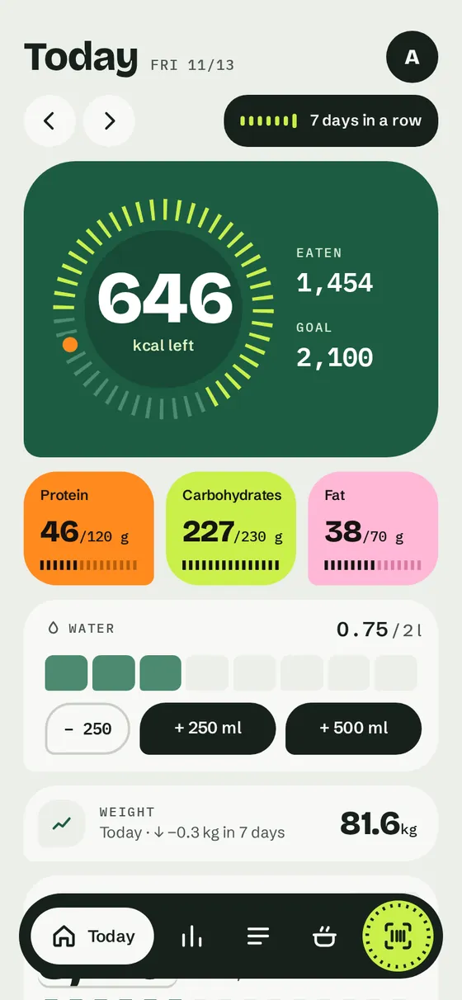
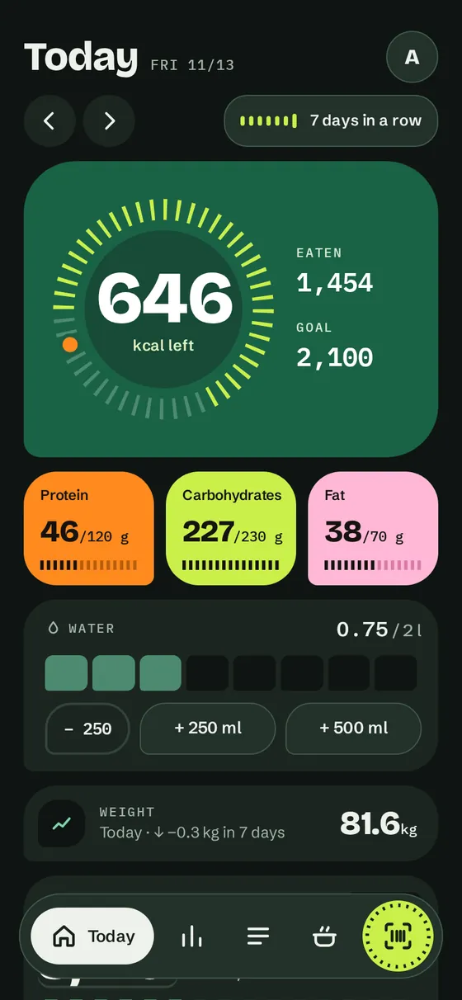
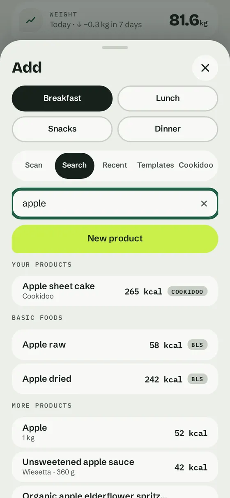
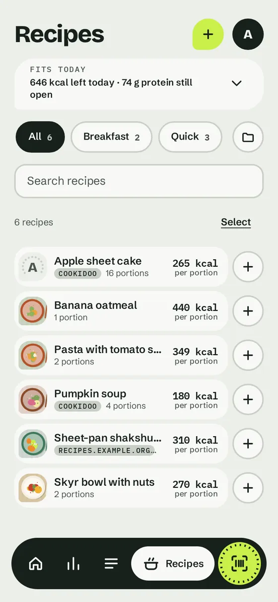
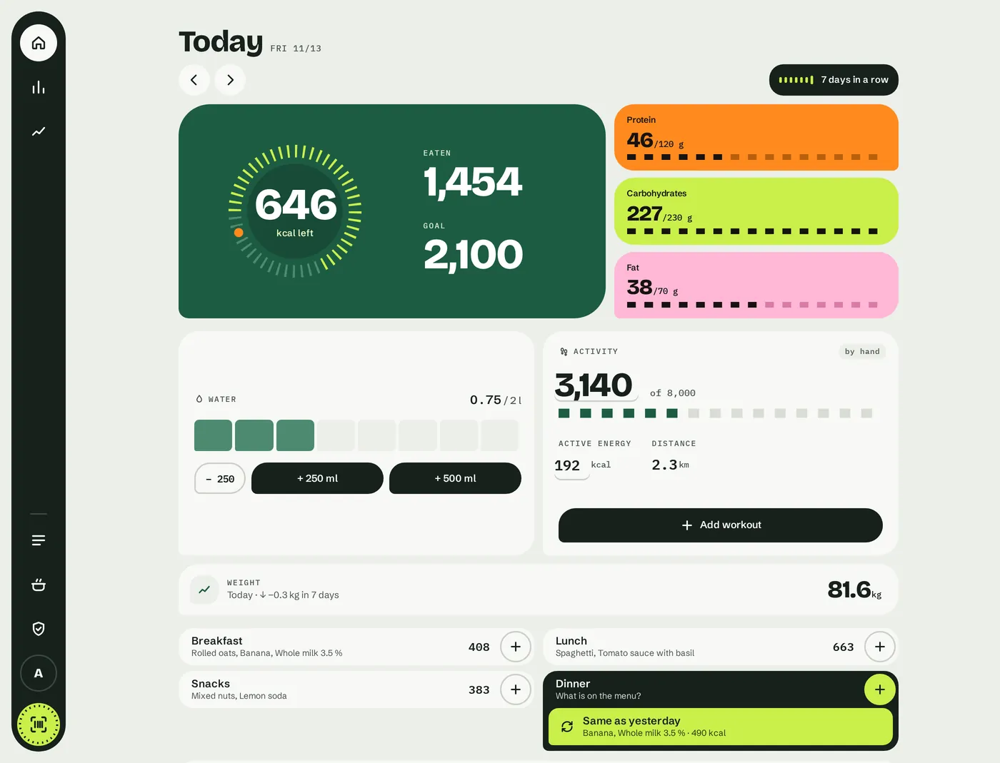
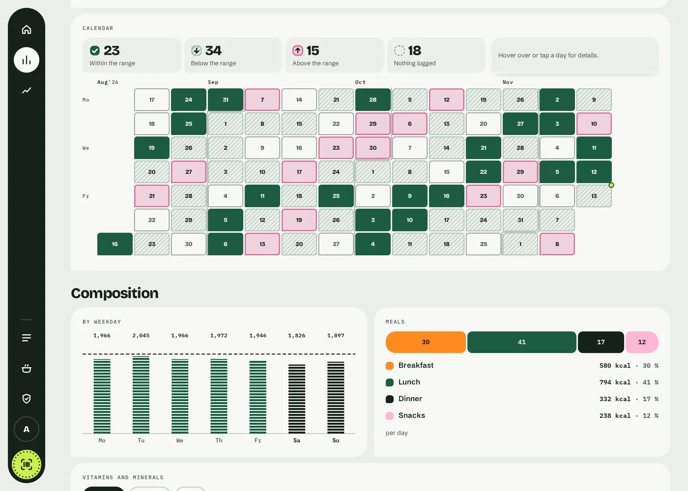

# Mahlwerk

[](https://github.com/mbrockeu/mahlwerk/actions/workflows/ci.yml)
[](LICENSE)

A self-hosted nutrition diary with barcode scanning: log meals in seconds, keep your data on your own server.

> **Status: young project (version 0.x).** It works for a household, but expect rough edges and breaking changes.
> See [Status and limits](#status-and-limits).

## Screenshots

The interface is available in German and English; the screenshots show invented demo data.

<p>
  
  
  
  
</p>
<p>
  
  
</p>

More screens, also of the German interface and the admin area, are in [docs/design/screens](docs/design/screens).

## Website and demo

The project page, with a clickable demo of the real interface on made-up data (no server, nothing is saved), is published at
<https://mbrockeu.github.io/mahlwerk/> once the repository is public. Source: [`site/`](site/); build it locally with
[`scripts/build-site.sh`](CONTRIBUTING.md#website-and-demo).

## Quick start

### With Docker Compose

```sh
cp .env.example .env     # set MAHLWERK_CONTACT to your own address
docker compose up -d
```

Then open <http://localhost:8110> and create the first admin account on the setup page (the Compose file starts
Mahlwerk with its own accounts, `MAHLWERK_AUTH=local`; do this right after starting). The database lives in the named volume `mahlwerk-data` (mounted at `/data` in
the container). The image does not include the optional label reader; build it in with
`docker compose build --build-arg WITH_LABEL=1` (about 200 MB more); the optional Cookidoo connector with
`--build-arg WITH_COOKIDOO=1` (see [Cookidoo](#cookidoo-optional)). **Back up the whole volume**: besides the database
it holds the key file (`mahlwerk.db.key`) that unlocks stored credentials (see [Stored credentials](#stored-credentials)).

> **Reaching it from other devices.** The Compose file publishes the port on `127.0.0.1` only. Put a reverse proxy
> with HTTPS in front instead of opening the port, and set `MAHLWERK_COOKIE_SECURE=1` and `MAHLWERK_TRUSTED_PROXIES`,
> see [Authentication](#authentication). The mode `single` (no login at all, the default when you run Mahlwerk
> without Docker and set nothing) is only for trying it out on your own machine: every request is one local user who
> is also an admin.

### Without Docker

You need Python 3.11 or newer and Node 20 or newer (the Docker image uses Python 3.13 and Node 22).

```sh
cd frontend && npm ci && npm run build && cd ..     # builds the interface into web/dist
python3 -m venv .venv
.venv/bin/pip install -e ".[label]"   # leave out [label] to skip the label reader (saves about 200 MB)
cp .env.example .env                  # set MAHLWERK_CONTACT
set -a; . ./.env; set +a
.venv/bin/uvicorn mahlwerk.main:app --factory --host 127.0.0.1 --port 8110
```

Browsers only hand out the camera on HTTPS (or `localhost`). To scan from a phone, put the service behind a reverse
proxy with a valid certificate. Append `?engine=wasm` to the URL to force the bundled barcode detector.

## Features

- **Day view.** Calories left, protein, carbohydrates and fat against your goal, four meals, a seven-day
  streak. Going over a goal is shown, never scolded.
- **Logging in seconds.** Scan a barcode with the phone camera, search, or pick from what you ate recently;
  the amount is pre-filled with the serving or your last amount.
- **Same as yesterday, and templates.** An empty meal offers to copy yesterday's with one tap (with undo); meals you
  eat often can be saved as templates and added again from the Add sheet.
- **Your own recipes.** Combine ingredients (also from the product catalogue) into a recipe with portions and an
  optional weight of the finished dish; it is calculated like any product and logged as "1 portion".
- **Recipe from an ingredient list.** Paste the ingredients of a cookbook or a web page (one per line, German or
  English: "200 g Mehl", "2 EL Olivenöl", "1 Dose Tomaten (400 g)", "½ bunch parsley"); Mahlwerk matches each line to a
  food (your own first, then the catalogue), works out the grams (typical sizes and densities, marked as estimates) and
  shows a check step before anything is added to the recipe. Deterministic, no AI model, no network.
- **Barcode scanning in the browser.** Installable web app, no app store. Uses the browser's built-in
  `BarcodeDetector` where available (Chrome on Android) and a bundled WebAssembly detector everywhere else
  (Safari on iOS). No CDN, no fonts or scripts from third parties.
- **Food data from Open Food Facts**, looked up once per barcode and kept in a local SQLite database.
- **Missing or wrong product?** Photograph the nutrition table instead of typing: the server reads it with
  local OCR ([RapidOCR](https://github.com/RapidAI/RapidOCR), runs on the CPU, nothing leaves your machine)
  and pre-fills the form. Guessed or implausible readings are flagged; you confirm before saving. Your own
  entries take precedence over Open Food Facts.
- **Find packaged products by name** without holding them: an optional local catalogue built from the Open Food
  Facts export and, for unpackaged foods, the BLS, searched offline and instantly (see [Product catalogue](#product-catalogue-and-data-sources)).
- **Activity.** Steps, active energy and workouts by hand, from the Yazio export or from Apple Health via a
  Shortcut (see [docs/integrations.md](docs/integrations.md)); optionally added to the calorie goal.
- **History and weight.** The last 14 days against your goal, and a weight curve.
- **Insights for years of data.** Up to ten years in days, weeks or months, comparison with the period before, zooming into a month or week, nutrient curves, a calendar heat map, a foods table with history per food and an estimate of the real energy expenditure (a rough estimate, not advice).
- **Playful feedback, never scolding.** Badges for habits (keeping at it, logging, eating in balance), a calm
  weekly review with one strength and at most one idea, a short celebration for a new badge. Never rewards eating
  less or losing weight; each person can switch it off.
- **Water.** A glass-stroke scale on the day view with quick buttons (+250 ml, +500 ml, take back), a daily goal in the profile and the daily average in the insights.
- **Fasting timer (optional).** Off by default; a dial of ticks counts the hours of an intermittent fast, start and end can be corrected. Never rewarded, no badge.
- **Recipes from Cookidoo (optional).** The Thermomix recipe platform as a source: this week's meal plan, your
  collections or a pasted recipe link become a food with the values per portion, one by one or a whole collection at
  once (slowly and carefully, see [Cookidoo](#cookidoo-optional)). Off by default.
- **Recipes from any web page (optional).** Paste the link of a recipe: the server reads the nutrition values the page
  publishes (schema.org, one page, public sites only) and, after a preview, takes over name, portions, values per portion and the
  link. No texts are kept; the page's picture only when an admin switches "Store recipe pictures" on. Off by default, see [Recipes from web pages](docs/integrations.md#recipes-from-web-pages).
- **Photo recognition (optional).** A photo of a meal becomes a list of parts with estimated amounts and values, a photo of a recipe
  becomes name, portions and ingredient lines, through an image model you configure (a local one such as Ollama, or any OpenAI-compatible
  provider). In the interface: "Photo of the meal" in the add sheet of the day view and "Photograph a recipe" on the Recipes page; each
  part is matched to a food of the database and checked by you before anything is booked or saved. Photos are shrunk in the browser
  and stripped of location data on the server, nothing is stored, the results are estimates to check. Off by default,
  see [Photo recognition](docs/integrations.md#photo-recognition).
- **What still fits today.** Recipes (own, Cookidoo, web) that suit the rest of the day: from your goal, what you ate and when
  you last ate each recipe, with an amount and a reason in words. A quiet card on the day view (switchable) and a section on the
  Recipes page. Worked out on your server, nothing is sent anywhere.
- **Recipe pictures.** A photo for any recipe (camera or file; shrunk in the browser, stored on your server): large in the
  detail, small in the list, tiny among the suggestions. Pictures of Cookidoo and web recipes can be fetched once and kept on your
  server when an admin switches it on per connector (off by default; the pictures belong to the providers, see
  [Recipe pictures](#recipe-pictures)). The browser never loads a picture from another site.
- **Recipe groups.** Group your own, Cookidoo and web recipes (a recipe can be in several), filter the list by group.
- **Several users.** Everyone sees only their own diary, goals and weight; the product list is shared.
- **Demo account (optional, admins only).** Keep your own account free of test data and still try or show the whole app with
  sample data: an admin switches the built-in demo account on in the admin area (off by default), then switches to it from the
  more menu or the profile (and back at any time; a band on every page says where you are). It is an invented user with 90
  days of sample entries, weights, water, activity and goals of its own; "Create sample data anew" starts it over, "Delete demo
  account" removes it. In it you can use the app like any user, but nothing of the household changes: products, recipes, groups and
  pictures are read-only, and there are no keys, webhooks, connectors or imports. Nobody can sign in as it, see
  [Trust model](#trust-model). The older "Demo data" option below fills your *own* account instead.

## Authentication

`MAHLWERK_AUTH` selects how callers are identified (see [Configuration](#configuration)):

- `single` (default): no login; every request is the one local user (`MAHLWERK_SINGLE_USER`, default `me`), who is
  an admin. Only for a private network or behind a proxy that does its own access control.
- `proxy`: a reverse proxy authenticates the user and passes the name in a header (default `Remote-User`). The
  header is trusted only when the TCP peer address is listed in `MAHLWERK_TRUSTED_PROXIES`; with an empty list every
  request is refused. Members of the group in `MAHLWERK_ADMIN_GROUP` (sent in `Remote-Groups`) are admins. Make sure
  the service is reachable only through the proxy, and that the proxy **removes or overwrites all three headers
`Remote-User`, `Remote-Name` and `Remote-Groups` that the client sent**. If it only sets the user header, any signed-in
user can send `Remote-Groups: admin` themselves and become an admin. nginx example (the names are the defaults):

  ```nginx
  location / {
      auth_request /auth;                              # your login check
      auth_request_set $user   $upstream_http_remote_user;
      auth_request_set $name   $upstream_http_remote_name;
      auth_request_set $groups $upstream_http_remote_groups;
      proxy_set_header Remote-User   $user;            # always set, so a client value never gets through
      proxy_set_header Remote-Name   $name;
      proxy_set_header Remote-Groups $groups;          # empty for a user without groups: still overwrites
      proxy_pass http://127.0.0.1:8110;
  }
  ```

- `local`: Mahlwerk has its own accounts, so it can run without a login proxy. The first visit shows a setup page that
  creates the first admin (possible only while nobody has a password; do it right after starting, before the address is
  known to others). The admin then adds users in the admin area (initial password, block, reset, admin right).
  Passwords are 10 to 256 characters and stored as scrypt; sign-in sets an `HttpOnly`, `SameSite=Lax` cookie that lasts
  30 days from the last use. Remote-User headers are ignored. Failed sign-ins slow down per user name and per address
  (from the 5th failure 2, 4, 8 ... seconds, at most 15 minutes; the counts live in the process memory).
  Details: `docs/api-v1.md`. When the database already holds users (a switch from `single` or `proxy`), the setup asks
  for a setup code: `MAHLWERK_SETUP_TOKEN`, or a random code the server writes once to its log at start. An empty
  database needs no code, so set it up right after starting. The interactive API docs (`/docs`, `/redoc`,
  `/openapi.json`) are off in this mode unless `MAHLWERK_DOCS=1`.

  **Use HTTPS.** Passwords and the cookie travel in clear text over plain HTTP. Put a TLS-terminating proxy in front.
  Behind such a proxy the app itself only sees HTTP, so set `MAHLWERK_COOKIE_SECURE=1` (or list the proxy in
  `MAHLWERK_TRUSTED_PROXIES` and let it send `X-Forwarded-Proto: https`) to give the cookie the `Secure` flag. Behind a
  proxy also list it in `MAHLWERK_TRUSTED_PROXIES`, otherwise all visitors share the proxy's address for the brake. There is no
  password reset by mail: an admin sets a new initial password; if the only admin forgot theirs, set a new hash by hand
  in the database.

- `oidc`: sign-in through an OpenID Connect provider (Authelia, Keycloak, Authentik, Pocket ID, ...) with the
  Authorization Code Flow and PKCE (S256). Mahlwerk has no passwords in this mode: the **Sign in with ...** button leaves
  for the provider and comes back with a session cookie, the same kind as in `local` mode (`HttpOnly`, `SameSite=Lax`,
  **7 days** from the last use and **30 days** at most in this mode, adjustable, see below; `local` keeps 30 and 180).
  Remote-User headers are ignored. Over HTTPS (`MAHLWERK_PUBLIC_URL` is `https`, or `MAHLWERK_COOKIE_SECURE=1`, in `local` too)
  the cookies are `Secure` and named `__Host-mahlwerk_session` / `__Host-mahlwerk_oidc` (Path `/`, no Domain, so a sibling
  site cannot plant them; only that name is read then); over plain HTTP the names are `mahlwerk_session` / `mahlwerk_oidc`. The
  `/docs`, `/redoc` and `/openapi.json` pages are off unless `MAHLWERK_DOCS=1`. Register Mahlwerk at the provider as a
  client with the redirect URI `<MAHLWERK_PUBLIC_URL>/api/v1/auth/oidc/callback`. The server does not start when a
  required setting is missing or wrong (the message names the variable).

  | Variable | Default | Meaning |
  | --- | --- | --- |
  | `MAHLWERK_OIDC_ISSUER` | required | Issuer URL, **character for character** as the provider writes it in its discovery document (`<issuer>/.well-known/openid-configuration`), a trailing slash included if the provider has one (Keycloak: `https://id.example.org/realms/home`). Must be `https`. Changing the issuer later cuts all links: users are tied to (issuer, `sub`), so everybody is a new user unless `MAHLWERK_OIDC_LINK_EXISTING=1` takes the old users over again by name, and sessions of the old issuer stop working. |
  | `MAHLWERK_OIDC_CLIENT_ID` | required | Client ID registered at the provider. |
  | `MAHLWERK_OIDC_CLIENT_SECRET` | empty | Client secret. Empty = public client, PKCE alone protects the code. Environment only; never shown or logged. |
  | `MAHLWERK_OIDC_CLIENT_AUTH` | `basic` | How the secret is sent to the token endpoint: `basic` (`client_secret_basic`) or `post` (`client_secret_post`). |
  | `MAHLWERK_PUBLIC_URL` | required | The address people use, e.g. `https://mahlwerk.example.org`. The redirect URI is built from it, never from the `Host` header. Alternatively `MAHLWERK_OIDC_REDIRECT_URL` with the full callback URL. Its host must be in `MAHLWERK_ALLOWED_HOSTS` if you set that. |
  | `MAHLWERK_OIDC_SCOPES` | `openid profile groups` | Scopes to request. `groups` is what Authelia, Authentik and Pocket ID use for the groups claim. With the default, scopes the provider does not list in `scopes_supported` are left out (so Keycloak, which has no `groups` scope unless you add one, does not refuse the request); scopes you set yourself are sent as they are. |
  | `MAHLWERK_OIDC_USERNAME_CLAIM` | `preferred_username` | Claim with the user name: 1 to 40 of `a-z 0-9 . _ -` after lower-casing (as in `local` mode). Anything else is refused. |
  | `MAHLWERK_OIDC_NAME_CLAIM` | `name` | Claim with the display name (falls back to the user name). |
  | `MAHLWERK_OIDC_GROUPS_CLAIM` | `groups` | Claim with the groups: a list of strings (a single string counts as one group). Members of `MAHLWERK_ADMIN_GROUP` (default `admin`) are admins; the name must match **exactly** (case, and for Keycloak the full path such as `/admin` if "full group path" is on). |
  | `MAHLWERK_OIDC_BUTTON_LABEL` | empty | Name of the provider for the button: "Sign in with *label*". Empty: "Sign in with single sign-on". |
  | `MAHLWERK_OIDC_LINK_EXISTING` | off | `1`: a person signing in for the first time takes over an existing user of the same name that has no provider link yet. See the warning below. |
  | `MAHLWERK_SESSION_DAYS`, `MAHLWERK_SESSION_MAX_DAYS` | `7`, `30` (`local`: `30`, `180`) | Sliding lifetime of a session and its absolute limit. A right taken away at the provider (admin group, account disabled) ends a running session only through this limit, so keep it short. |
  | `MAHLWERK_OIDC_ALLOW_HTTP` | off | `1` allows plain `http` for issuer, endpoints and public URL, but only on loopback hosts (`localhost`, `127.0.0.0/8`, `::1`); anything else is a start error. For tests and a provider on the same machine. **Unsafe** (see SECURITY.md). An `https` issuer never gets `http` endpoints, with or without it. |
  | `MAHLWERK_ALLOWED_HOSTS` | the host of `MAHLWERK_PUBLIC_URL`, plus `localhost`, `127.0.0.1`, `[::1]` | In this mode the host check is on by default (DNS rebinding). Set the variable to change it (`*` = any). `/healthz` is exempt. Behind a proxy that rewrites the `Host` header, list what arrives here. |

  Users are identified by the provider's stable `sub` (together with the issuer), not by the name: when the name changes at
  the provider the account stays the same (the display name follows, the user name here does not). The first sign-in creates
  the user. The admin right and the display name are taken from the claims **at every sign-in**; taking someone out of the
  admin group, or disabling them, at the provider therefore takes effect only at their next sign-in: until then a running
  session keeps its right (at most `MAHLWERK_SESSION_DAYS` of silence, `MAHLWERK_SESSION_MAX_DAYS` in all). An admin can block a
  user in the admin area, which ends their sessions and access keys at once. A session counts only for a user who has a link at
  the *configured* issuer, so sessions left over from `local` mode or from another provider are dead (and stay dead after the
  link is made).
  **Access keys** (`mw_...`) are independent of the sign-in mode and keep working after a switch; revoke them in the Profile
  (Access keys) or by blocking the user.

  Pending sign-ins are not stored on the server: the cookie `mahlwerk_oidc` carries state, nonce, PKCE verifier, target and
  expiry, signed with an HMAC (key made at first use and kept in the database). Several workers and restarts do no harm.
  One cookie means one sign-in at a time per browser: a second tab replaces the first, and the first one's answer then shows the
  plain "did not work, try again". Login and callback are limited to 30 requests per address and minute each (in process memory).
  If the provider announces `authorization_response_iss_parameter_supported`, the `iss` parameter in the answer is required.

  **Moving from `proxy` or `single`.** Diaries made in those modes belong to user rows that have no provider link. With
  `MAHLWERK_OIDC_LINK_EXISTING=1` the first sign-in of a person whose provider user name equals such a user name takes that
  diary over, and from then on only `sub` counts. This is safe only if the provider decides the names and nobody can
  register or rename themselves into someone else's name (in `proxy` mode you trusted the same names already; from `single`
  the one user is called `me`, so make sure nobody at the provider can be called that). Switch it off again once everybody has
  signed in once. Without it, signing in under an existing name is refused ("A diary with this user name exists here ...").

  Example client for Authelia (`configuration.yml`, identity provider section; keep the secret in a file or secret store):

  ```yaml
  identity_providers:
    oidc:
      clients:
        - client_id: mahlwerk
          client_name: Mahlwerk
          client_secret: '$pbkdf2-sha512$...'   # hash of the secret; omit and set public: true for a public client
          public: false
          authorization_policy: one_factor
          require_pkce: true
          pkce_challenge_method: S256
          redirect_uris:
            - https://mahlwerk.example.org/api/v1/auth/oidc/callback
          scopes: [openid, profile, groups]
          response_types: [code]
          grant_types: [authorization_code]
          token_endpoint_auth_method: client_secret_basic
  ```

  Other providers: create an OpenID Connect client of the "web application" kind with the same redirect URI, the code flow
  and PKCE, and make sure the user name (`preferred_username`) and a group list are in the ID token or the userinfo answer
  (Keycloak: a "groups" mapper on the client; set `MAHLWERK_OIDC_GROUPS_CLAIM` and the scopes if yours are named differently).
  Mahlwerk asks the userinfo endpoint when the ID token lacks one of these claims. There is no sign-out at the provider
  (no RP-initiated logout): "Sign out" ends the session on this server, and the next sign-in is instant while the provider
  session lives. Mahlwerk keeps no refresh token and does not poll the provider.
  The ID token's signature is not verified, by design; read the reasoning and the assumption behind it in
  [SECURITY.md](SECURITY.md) before you use this mode. Use HTTPS in front of Mahlwerk.
  **Certificates.** Mahlwerk checks the provider's certificate against the CA bundle shipped with `certifi` (not the system
  store). A provider with its own certificate authority needs `SSL_CERT_FILE` (or `SSL_CERT_DIR`) pointing at the CA, in
  the environment of Mahlwerk. The proxy variables (`HTTPS_PROXY`, `NO_PROXY` ...) are honoured for the calls to the provider.
  **Below a path prefix** (`https://example.org/food/`): the interface and the API work behind a proxy that strips the prefix
  (the interface uses relative addresses); put the full public address, prefix included, in `MAHLWERK_PUBLIC_URL`. Mahlwerk
  itself does not serve below a prefix and this has not been tried with a real proxy; the cookies use Path `/` either way.

Personal access keys (`Authorization: Bearer mw_...`) work in every mode; a key is never an admin. A blocked account's keys stop working.
Every answer carries `X-Content-Type-Options: nosniff`, `Referrer-Policy: same-origin`, `X-Frame-Options: DENY`; the
interface also gets a Content-Security-Policy that allows only its own files plus WebAssembly for the barcode reader
(`'wasm-unsafe-eval'`), the hash of the one inline theme script, inline styles, and `data:`/`blob:` images.

**CSRF header, all modes.** Every `POST`, `PUT`, `PATCH` and `DELETE` below `/api/` needs the header
`X-Mahlwerk-Request: 1` unless it carries a bearer key (the interface always sends it). A page on another site cannot
add a custom header without a CORS pre-flight, and Mahlwerk sends no CORS headers. This protects `single` (no login) and
`proxy` (the proxy's login) as well as `local`. Existing scripts without a key must add the header.

**Host check.** `MAHLWERK_ALLOWED_HOSTS` lists the host names the server answers to (without port, `*` = any); a
request with another `Host` header gets `421`. It stops DNS rebinding, where a hostile web page makes your browser talk
to the server under the attacker's name. Default: in `single` mode only `localhost`, `127.0.0.1` and `[::1]` (set the
name you use if you open it by LAN name); in `proxy`, `local` and `oidc` mode no check unless you set the variable, which you
should. `/healthz` is exempt.

**Request size.** Bodies over 1 MB are refused with `413` (8 MB for the label photo and the Health sync), also when
streamed without a length. The one exception is the upload of a Yazio export (`PUT /api/v1/me/yazio/files/...`): 24 MB as
sent: 24 MB. Set limits at your reverse proxy as well (nginx: `client_max_body_size 8m;`, and **at least 24m** if people upload a
Yazio export; the browser packs the files with gzip first, which usually keeps them far below that, and a ZIP is always an
option).

### Trust model

- Products, recipes and their nutrient data are **shared by all users of an installation** and every user can change
  them. Do not give accounts to people you would not trust with that.
- Diary, goals, weights, keys and webhooks are per user; admins see only counts.
- **The demo account is not a way to sign in as someone else.** There is exactly one account an admin can switch to, the built-in
  demo account (the user row `~demo`, a name no sign-in mode can produce: nobody can sign in as it or be mapped to it by a proxy
  header, a provider claim or `MAHLWERK_SINGLE_USER`; a real user called `demo` is unaffected). It is **not a guest mode**: "Back"
  always works, and whoever holds your signed-in device holds your admin account. The switch is an extra signed `HttpOnly` cookie
  next to your real sign-in, valid for 12 hours (2 hours in `single` and `proxy` mode, where it is tied to the user only and
  outlives a sign-out at the proxy for that time; use HTTPS and `MAHLWERK_COOKIE_SECURE=1` for the `__Host-` prefix), tied
  to your user and (where there is one) your session; every request says which account the page shows, and a write for the
  other one is refused (`409 view changed`), so a second tab cannot book into the wrong diary; it is checked again on every request and counts only while you are still
  an admin and the demo account is on. Access keys ignore it. In the demo view the server enforces one table of what is
  allowed (own data yes; shared products, recipes, groups, pictures, keys, webhooks, connectors, imports and the admin area no;
  nothing is sent to webhooks), so the household's data stays as it is. The demo account's sample foods are marked and do not exist
  for anybody else.
- **Recipe pictures are shared like the recipes:** a photo someone sets for a recipe is visible to everybody on the server (and to
  their read access keys), and anyone can replace or remove it. Do not use photos you would not show the household. The server
  strips every piece of metadata (EXIF with GPS position, camera, comments) before it stores a picture.
- The login brake keeps its counts in the memory of the process, so run **one worker** (the default). A restart resets it.
- Webhook targets must be public addresses unless an admin lists the host (see `docs/integrations.md`).
- **Recipes from web pages (optional, off by default)** make the server fetch addresses that signed-in people type. The
  fetch is limited to public websites (never an address inside your network; your own domains are blocked, see `MAHLWERK_WEB_RECIPES_BLOCKED_HOSTS`), braked and checked at every step; **the address of a recipe, with its query, is saved and visible to everybody on the server, so do not paste links with personal share tokens** (only tracking parameters are removed); see
  [What leaves your server](#what-leaves-your-server) and `docs/integrations.md`. A recipe taken over this way is shared with
  everybody on the server like every food.
- **Cookidoo recipes are shared.** A recipe someone takes over becomes a food for the whole installation, also when it
  came from that person's own Cookidoo account: whoever takes it over shares the recipe's name and nutrition values (not its
  texts, which are never stored) with everybody else on the server. The meal plan and collections of an own account are
  shown only to its owner.
- Credentials that people or admins store for other services (Cookidoo) are kept encrypted in the database, see
  [Stored credentials](#stored-credentials); they are never shown again, not even to admins. Admins can remove them.
- An upload for the Yazio import is held in memory only, per person, for 20 minutes, and can only be imported into the
  uploader's own account.
- A key survives a password change by its owner; an admin's password reset revokes the user's keys. Sessions end
  after 180 days at the latest, however often they are used.

### Stored credentials

Some connectors need a password of another service (Cookidoo). Mahlwerk can keep it for you, **encrypted in the database**
with AES-256-GCM (the `cryptography` package; no home-made cryptography). Each value has its own random nonce and is bound
to its row, so a value copied into another row does not decrypt.

- **The key** is `MAHLWERK_SECRET_KEY` (a text of at least 32 characters; use `openssl rand -base64 32`). The key is
  derived from it with scrypt and a random salt kept in the database (so a short phrase costs an attacker real work per
  guess, and every installation stretches differently), otherwise a key file next to the database (`<database>.key`, in Docker `/data/mahlwerk.db.key`): 32 random
  bytes as hex, mode `0600`, created without ever overwriting an existing file, only when the first credential is stored.
- **What it protects:** a copy of the database (a backup, a leaked dump) alone does not reveal the credentials in it.
- **What it does not protect:** whoever has the running server, its environment or the key file can read them, because the
  server must be able to present them to the other service on its own. Treat the key like the credentials themselves.
- **Back up the key file with the database**, but not in the same place if you can avoid it (that would undo the point of
  the encryption for a stolen backup). A database restored without its key is not broken: the stored credentials simply count
  as "not there", the admin area and the profile say so ("enter it again"), and you enter them once more. The same happens
  when `MAHLWERK_SECRET_KEY` changes. An unusable key (too short, a damaged key file) makes storing fail with a clear message;
  an existing key file is never overwritten.
- **They never leave:** the API only says whether a credential is set (and shows the e-mail address masked, `a***@example.org`);
  nothing is logged or put into an error message; access keys cannot read or set them.
- Passwords of the Mahlwerk sign-in itself are not stored this way (they are hashed with scrypt), and the direct Yazio
  sign-in stores nothing at all.

## What leaves your server

Mahlwerk makes no connection that you did not switch on or ask for, and has no analytics. What it can send out:

| What | To whom | When | What is sent |
| --- | --- | --- | --- |
| Product lookup | Open Food Facts | a barcode or product is looked up (admin can switch it off) | the barcode, a `User-Agent` with `MAHLWERK_CONTACT` |
| Catalogue refresh | Open Food Facts (download) | an admin starts it | nothing about people |
| Webhooks | the URLs people register (public addresses unless an admin lists the host) | an event happens | the event, signed |
| Cookidoo (off by default) | Cookidoo | a person uses the connector | the account's sign-in, recipe ids |
| Yazio sign-in (off by default) | Yazio | a person uses it | the sign-in, once, not stored |
| **Recipes from web pages** (off by default) | the site a person pastes the link of | a person previews or takes over a link (once per address and 5 minutes) | an ordinary `GET` of that page (up to 10 seconds, 3 MB): the address, a `User-Agent` with the project name and `MAHLWERK_CONTACT`, no cookies, no `Referer`, nothing about the person or the diary |
| **Recipe pictures, Cookidoo** (off by default, own switch) | the picture host Cookidoo names in the recipe details | a recipe is taken over or reloaded, or the catch-up run is started | an ordinary `GET` of that one picture address (public addresses only, up to 10 seconds, 6 MB), same `User-Agent`, no cookies, no `Referer` |
| **Recipe pictures, web** (off by default, own switch) | the host of the picture a recipe page names | a recipe is taken over or reloaded | the same, for that one picture |
| **Photo recognition** (off by default, needs a model you configure) | the image model at `MAHLWERK_VISION_URL`: a local one or a provider you chose | a person sends a photo of a meal or a recipe | the photo (shrunk, as a new JPEG without EXIF or location) and a fixed prompt; nothing about the person or the diary; nothing is stored here |
| Own recipe photos | nobody | – | nothing: the photo goes from your browser to your server only |
| What still fits today | nobody | – | nothing: it is computed on the server from your own data |

The label reader (OCR) and the barcode detector run on your own machine. The interface loads no fonts, scripts or images from
other sites.

## Configuration

All settings are environment variables (see `.env.example`). The Docker image sets `MAHLWERK_DB=/data/mahlwerk.db` and `MAHLWERK_WEB_DIR=/app/web`.

| Variable | Default | Meaning |
| --- | --- | --- |
| `MAHLWERK_DB` | `./data/mahlwerk.db` | SQLite file, created on first start. A database from the scan prototype is migrated automatically. |
| `MAHLWERK_CATALOG_DB` | `catalog.db` next to `MAHLWERK_DB` | Local Open Food Facts catalogue (see above). Optional; a missing file is an empty catalogue. |
| `MAHLWERK_CATALOG_BLS_DB` | `catalog-bls.db` next to the file above | Local basic foods catalogue from the BLS (see above). Optional; a missing file is empty. |
| `MAHLWERK_CONTACT` | – | Contact address sent to Open Food Facts in the User-Agent. |
| `MAHLWERK_AUTH` | `single` | `single`: no login, one local user. `proxy`: trust the user name a reverse proxy sends. `local`: own accounts with passwords. `oidc`: sign in through an OpenID Connect provider, see its `MAHLWERK_OIDC_*` variables there. See [Authentication](#authentication). |
| `MAHLWERK_COOKIE_SECURE` | off | `1` gives the session cookie of `local` mode the `Secure` flag even though the app sees plain HTTP (TLS proxy in front). Also set automatically for HTTPS requests. |
| `MAHLWERK_SINGLE_USER` | `me` | User name in `single` mode. |
| `MAHLWERK_TRUSTED_PROXIES` | empty | Comma-separated IPs of the proxies allowed to set the user header (`proxy` mode). Only the TCP peer address counts, never `X-Forwarded-For`. With an empty list every request is refused. In `local` mode it only decides whose `X-Forwarded-Proto` / last `X-Forwarded-For` entry is believed. |
| `MAHLWERK_PROXY_USER_HEADER` | `Remote-User` | Header carrying the user name. |
| `MAHLWERK_PROXY_NAME_HEADER` | `Remote-Name` | Header carrying the display name. |
| `MAHLWERK_PROXY_GROUPS_HEADER` | `Remote-Groups` | Header with the user's groups, comma separated (`proxy` mode). |
| `MAHLWERK_ADMIN_GROUP` | `admin` | Group whose members are admins (`proxy` and `oidc` mode). In `single` mode the one user is an admin. |
| `MAHLWERK_TOKENS` | on | `off` switches personal access tokens off (fixed, the admin area shows it as such). |
| `MAHLWERK_WEBHOOKS` | on | `off` switches outgoing webhooks off. |
| `MAHLWERK_WEBHOOK_HOSTS` | empty | Comma-separated hosts webhooks may target. Empty: any host with a public address. A listed host is the only kind allowed and may be internal (Home Assistant in the LAN). |
| `MAHLWERK_ALLOWED_HOSTS` | `single`: `localhost,127.0.0.1,[::1]`; else no check | Host names (no port) the server answers to, `*` = any; others get 421. Set it behind a proxy and when you use a LAN name. `/healthz` is exempt. |
| `MAHLWERK_SETUP_TOKEN` | random, logged once | `local` mode, database with existing users: code the setup page asks for. |
| `MAHLWERK_DOCS` | off in `local` and `oidc` | `1` keeps `/docs`, `/redoc` and `/openapi.json` in these modes (always on in the other modes). |
| `MAHLWERK_OFF_LOOKUP` | on | `off` stops live lookups at Open Food Facts (local catalogue only). |
| `MAHLWERK_OFF_COUNTRIES` | `en:germany` | Countries of the catalogue refresh in the admin area. |
| `MAHLWERK_WEB_RECIPES` | off | `on` / `off` fixes the switch of the connector "Recipes from web pages" (the admin area shows it as fixed). Without it the admin decides; default off. The fetch sends `MAHLWERK_CONTACT` in its `User-Agent`. |
| `MAHLWERK_WEB_RECIPES_BLOCKED_HOSTS` | – | Comma separated names the web-recipe fetch must never contact; an entry blocks the name and all subdomains. The host of `MAHLWERK_PUBLIC_URL` and the names in `MAHLWERK_ALLOWED_HOSTS` are blocked automatically. **List your own domains before you switch the connector on** (a public name can lead back into your network through the router). |
| `MAHLWERK_VISION` | off | `on` / `off` fixes the switch of the connector "Photo recognition" (the admin area shows it as fixed). Without it the admin decides; default off. |
| `MAHLWERK_VISION_URL`, `MAHLWERK_VISION_MODEL`, `MAHLWERK_VISION_KEY` | – | The image model: the base address of an OpenAI-compatible API (e.g. `http://127.0.0.1:11434/v1`), the model name and, optionally, a key (sent as a Bearer token, never shown). An internal address is allowed on purpose. See [Photo recognition](docs/integrations.md#photo-recognition). |
| `MAHLWERK_VISION_PER_HOUR` | `30` | Photos per person and hour for photo recognition. |
| `MAHLWERK_VISION_PARALLEL` | `2` | Photo recognition runs at the same time on the whole server (1 to 8). Keep the key in a `0600` environment file, not in a unit file. |
| `MAHLWERK_COOKIDOO` | off | `on` / `off` fixes the Cookidoo connector switch (the admin area shows it as fixed). Without it the admin decides; default off. |
| `MAHLWERK_COOKIDOO_IMAGES` | off | `on` / `off` fixes the switch "Store recipe pictures" of the Cookidoo connector. Without it the admin decides; default off. |
| `MAHLWERK_WEB_RECIPES_IMAGES` | off | The same for recipes from web pages. |
| `MAHLWERK_IMAGES_MAX_MB` | `1024` | Upper limit for the recipe pictures folder (`<database>.images` next to the database), in MB. A picture that would not fit is refused with a clear message. |
| `MAHLWERK_COOKIDOO_PERSONAL` | on | `off` forbids people to add an own Cookidoo account in their profile (fixed, the admin area shows it as such). |
| `MAHLWERK_COOKIDOO_EMAIL`, `MAHLWERK_COOKIDOO_PASSWORD` | – | The shared household Cookidoo account. If set they win over an account stored in the admin area, which then shows "set by the environment" and cannot be changed there. Never shown anywhere. |
| `MAHLWERK_SECRET_KEY` | key file | Key for credentials stored in the database (at least 32 characters, `openssl rand -base64 32`). Without it a key file `<database>.key` is made on first use, see [Stored credentials](#stored-credentials). |
| `MAHLWERK_YAZIO_LOGIN` | off | `on` / `off` fixes the switch of the direct Yazio sign-in (unofficial, off by default, see [Importing from Yazio](#importing-from-yazio)). |
| `MAHLWERK_YAZIO_CLIENT_ID`, `MAHLWERK_YAZIO_CLIENT_SECRET` | – | The identifiers of the Yazio app, needed for the direct sign-in (not part of Mahlwerk, see below). Without them the sign-in is unavailable. |
| `MAHLWERK_COOKIDOO_COUNTRY` | `de` | Cookidoo country (two letters). |
| `MAHLWERK_COOKIDOO_LANGUAGE` | `de-DE` | Cookidoo language (`xx-YY`). |
| `MAHLWERK_WEB_DIR` | `web/dist` | Built frontend to serve; unknown paths get `index.html`. Not served if the directory does not exist. |
| `MAHLWERK_OFF_BASE` | `https://world.openfoodfacts.org` | Open Food Facts base URL. |
| `MAHLWERK_CACHE_DAYS` | `30` | How long a looked-up product is trusted before asking again. |
| `MAHLWERK_DEMO_DATA` | off | `1` or `true` lets each user fill their profile with invented demo entries and remove them again (Profile, section Demo data). Test data in the *own* account; for clean testing use the demo account below. |
| `MAHLWERK_DEMO_ACCOUNT` | off | `on` / `off` fixes the switch of the built-in demo account that admins can switch to (admin area, Import and demo). Without it the admin decides. |
| `MAHLWERK_LABEL_DEBUG_DIR` | off | Keep the last 20 label photos and OCR text here. |

API documentation: `/docs` (Swagger UI).

## Product catalogue and data sources

Search finds what was scanned or entered before. To find packaged products by name as well, load a local catalogue
once; it is a separate SQLite file that the server only reads:

```sh
.venv/bin/python -m mahlwerk.catalog import-off                      # Germany; add --country en:france (repeatable)
.venv/bin/python -m mahlwerk.catalog import-off --source off.csv.gz  # or from a file you downloaded yourself
```

The import streams the official Open Food Facts CSV export (about 1.5 GB gzip, nothing is unpacked to disk), keeps
products of the chosen countries that have a name and an energy value, and drops implausible values. Expect a download of
1.5 GB, roughly 5 to 15 minutes of CPU time and a catalogue in the order of 100 to 300 MB for a large country;
the temporary file needs the same space again. The new file replaces the old one only at the end, so a running server keeps working and
sees the new catalogue on its next request; re-run it now and then to refresh. A barcode lookup consults the
catalogue before asking Open Food Facts live. Without a catalogue file the app works as before.

Open Food Facts data is licensed under the [ODbL](https://opendatacommons.org/licenses/odbl/1-0/) and must be
attributed. This repository contains no data: every installation downloads its own copy. Wrong or missing product data
is best fixed at the source, at [Open Food Facts](https://world.openfoodfacts.org).

### Basic foods (BLS)

Packaged products are only half of what people eat. For unpackaged foods (apple, bread, cooked potatoes, dishes) the
catalogue can also hold the **Bundeslebensmittelschlüssel (BLS) 4.0** of the Max Rubner-Institut: about 7,100 foods
with up to 138 nutrients per 100 g, in German and English. Request the data table (.xlsx) from
[blsdb.de](https://blsdb.de) (DOI [10.25826/Data20251217-134202-0](https://doi.org/10.25826/Data20251217-134202-0)),
then:

```sh
.venv/bin/python -m mahlwerk.catalog import-bls BLS_4_0_Daten_2025_DE.xlsx   # a CSV export of the same table works too
```

The import reads the workbook with the standard library only (about 10 seconds), finds the nutrients by the BLS tags
of the header row, converts units, and prints a summary (rows, kept, discarded with reasons, missing tags). It writes
its own file (`catalog-bls.db` next to the other one, or `MAHLWERK_CATALOG_BLS_DB`) and replaces it atomically; the
Open Food Facts file is not touched, and the other way round. The search then lists up to eight basic foods first,
then packaged products, and the profile shows both sources. Picking a basic food stores it as a food (`bls`).

Citation: Max Rubner-Institut (2025): Bundeslebensmittelschlüssel (BLS), Version 4.0 – Deutsche Nährstoffdatenbank.
Karlsruhe. This repository contains no BLS data: every installation loads the file itself, subject to the terms of
the Max Rubner-Institut.

## Cookidoo (optional)

Takes recipes from [Cookidoo](https://cookidoo.international/) (Thermomix) over as foods with their nutrition values
per portion. **It uses an unofficial interface** (the community package [`cookidoo-api`](https://github.com/miaucl/cookidoo-api),
MIT) that Cookidoo does not offer or support and that can stop working at any time. Using it is your own responsibility;
check that it is in line with Cookidoo's terms of use for your account.

- **Install:** `pip install "mahlwerk[cookidoo]"` (needs Python 3.12 or newer; Docker: `--build-arg WITH_COOKIDOO=1`).
  Without it Mahlwerk starts as usual and the connector card in the admin area says "Not installed".
- **Configure the shared household account** in the admin area (card Cookidoo: e-mail address, password, country, language;
  then "Check connection") and switch the connector on. Or set `MAHLWERK_COOKIDOO_EMAIL` and `MAHLWERK_COOKIDOO_PASSWORD`
  (and, outside Germany, `MAHLWERK_COOKIDOO_COUNTRY` / `MAHLWERK_COOKIDOO_LANGUAGE`) in the server environment: the
  environment wins, and the card then says "set by the environment". A stored account is kept encrypted (see
  [Stored credentials](#stored-credentials)); nothing is ever logged or returned by the API.
- **An own account per person (optional).** In the profile (card Connections) everybody can add an own Cookidoo account;
  its meal plan, collections and recipe lookups then use it instead of the shared one. An admin can forbid this (switch
  "Own accounts" on the card, or `MAHLWERK_COOKIDOO_PERSONAL=off`). Each account has its own sign-in, caches and brakes;
  credentials are never mixed between people. **A recipe taken over from your own account is shared with the household**
  (see the trust model), the meal plan and collections stay yours. Removing an account, changing it or signing out drops
  its sign-in at once.
- **Without an own account** every user sees the meal plan and collections of the shared account; the
  taken-over foods are shared like all foods, the diary entries stay private to each user.
- **Use:** the Recipes page has a "Take over from Cookidoo" button (the Add sheet has a "Cookidoo" tab too): this week's plan
  (names only, no pictures), your collections and a field for a recipe link or ID. Taking over creates (or updates) an entry
  named like the recipe. Taken-over recipes stand in the Recipes list beside your own, marked "Cookidoo", with the values per
  portion and a link to the recipe at Cookidoo (Cookidoo keeps ingredients and steps); "Reload from Cookidoo" refreshes the
  values, "Remove" deletes the entry (diary entries already made keep their values). They are not listed under Products,
  but the Add sheet finds them. Amounts are typed and shown as portions; internally a portion is stored as 100 g.
  Switched off, the taken-over recipes stay visible and loggable; only taking over and reloading disappear.
- **Take over many at once.** A collection ("Take over all"), the week ("Take over the week") or everything: a background run
  that fetches one recipe every 3 seconds at most (100 recipes take about 5 to 6 minutes; the question before the start says
  how long), with a call budget of its own so the pages stay usable, at most 500 recipes, one run per account. Recipes taken
  over in the last 7 days are skipped, so running it again is cheap. It stops at once on a refused sign-in or a brake, lists
  recipes that failed or have no values, can be stopped any time, and does not survive a server restart (what was saved
  stays). A collection also becomes a recipe group of the same name. Details: [docs/integrations.md](docs/integrations.md#taking-over-many-recipes-at-once).
- **What is kept:** only the name, the number of portions, the nutrition values and the recipe ID (and the address of its
  picture). Recipe texts (ingredients, steps) are not stored; the picture only when an admin switches "Store recipe pictures" on
  (see [Recipe pictures](#recipe-pictures)), then as a small copy on your server (fetched again only when you reload the recipe or the address changed). Values come as Cookidoo states them: energy (kcal, else kJ), fat,
  saturated fat, carbohydrates, protein, fibre and sodium (salt is calculated from it); missing values stay empty. A recipe without an energy
  value is refused.
- **Limits:** Cookidoo is asked only by signed-in users (not with access keys); lists are loaded at most once a minute, at
  most 30 calls in five minutes per account (120 for all accounts together), at most 6 signed-in clients are held at once
  (idle ones are closed after 30 minutes). **Sign-ins are rationed so that Cookidoo is not hammered with wrong passwords**:
  a refused sign-in is not retried for five minutes; per account holder (the shared account, or one person) at most 5
  refused sign-ins an hour are tolerated, after that none is even tried until the hour has passed, **changing or removing and
  re-adding the stored account does not reset that count**; at most 20 sign-ins an hour for all accounts together; "Check
  connection" is not repeated within 30 seconds. This limits the load and the chance that Cookidoo locks an account; it
  cannot promise that it never does. Custom ("created")
  recipes of the account cannot be taken over.

## Recipe pictures

- **Own photos** (always possible, no switch): in the recipe editor or the detail of any recipe, "Add photo" opens the file
  chooser (on a phone: camera or library; the editor also offers "Take photo"). The browser shrinks the photo first, the server
  keeps it. An own photo always wins: reloading a recipe from Cookidoo or its web page never replaces it. "Remove photo" takes it
  away (for a provider's picture this is remembered, so a reload does not bring it back; "Restore provider picture" lifts that while the
  switch is on). Own photos: at most 20 per person in 10 minutes.
- **Provider pictures** (off by default, a switch per connector in the admin area, or `MAHLWERK_COOKIDOO_IMAGES` /
  `MAHLWERK_WEB_RECIPES_IMAGES`): when a recipe is taken over or reloaded, its picture is fetched and a small copy is kept
  on your server; **a picture of the same address that is stored already is not fetched again** unless you reload the recipe, every fetch
  counts against the same brake as web pages (Cookidoo: its own), and nothing about the address is kept while the switch is off. **The pictures belong to the providers; storing them is meant for your own household and is your responsibility.**
  Cookidoo names the picture in its recipe details; for recipes taken over before the switch was on, the Cookidoo dialog offers
  "Fetch missing pictures": a background run at the pace of "take over many" (one call to Cookidoo every 3 seconds at most, and only
  for recipes whose picture address is not known yet). Web recipes get their picture on "Reload from <host>" (one fetch of the page and
  one of the picture); there is deliberately no run that fetches many web pages.
- **Processing:** the server accepts JPEG, PNG and WebP only (no SVG, GIF, AVIF or HEIC), at most 8 MB (uploads) or 6 MB (provider
  pictures) and 24 megapixels (read from the file header before anything is decoded). It is decoded in a separate process with
  limits on memory, time and rights ([Pillow](https://python-pillow.org); resource limiting, not a full sandbox: keep Pillow up to date), turned as the camera says, **stripped of every piece of metadata**
  (EXIF with GPS position, XMP, comments; an embedded colour profile is discarded and the pixels count as sRGB), transparency laid on the paper colour, and stored
  as three WebP files: 960 px (detail, below about 150 KB), 240 px and 96 px (square, list and suggestions). Animations keep their
  first picture.
- **Storage:** the folder `<database file name>.images` next to the database (e.g. `mahlwerk.db.images`, with a marker file; a folder without the marker is never touched) (in Docker inside the `/data` volume), files named by their content hash,
  mode `0600`. A picture no recipe uses any more is deleted when it is replaced or removed, and leftovers are tidied at start-up.
  The folder has an upper limit (`MAHLWERK_IMAGES_MAX_MB`, default 1 GB). A day's write also tidies leftovers.
- **Delivery:** `GET /api/v1/images/<hash>/<size>`, only for signed-in people (and read access keys), cached by the browser for a year
  (the address changes when the picture does; on a shared device the pictures stay in the browser cache after sign-out: clear the site data). The interface never loads a picture from another site.
- **Backup:** back up the `<database file name>.images` folder together with the database. A database restored without it simply shows recipes without
  pictures (no error); a placeholder takes their place.

## Importing from Yazio

Coming from Yazio? Take your history along. The unofficial "yazio-exporter"
tools (not part of Mahlwerk, not endorsed by Yazio) write the data of your own account as JSON files into a folder
(`products.json`, `days.json`, `weight.json`; other files are ignored). There are three ways in, all ending in the same
import code, the same preview numbers and the same batch that can be taken back:

**In the app, from the files (the normal way).** Profile, card "Import from Yazio": choose the three files (or a ZIP of the
folder). They are uploaded, you see a preview (days, entries by kind, new foods, weights, water, activity, what exists
already, what is skipped and why) and nothing is written until you press Import. Re-uploading the same files imports
nothing twice. Notes: the browser packs the files with gzip before sending where it can, because a proxy in front often
limits request bodies (set `client_max_body_size 24m;` in nginx if you want to send big plain files; a real export is a few MB); uploads live in the
server's memory only (never on disk), per person, for 20 minutes. The limits are set from what an export is (12,000 entries on
1,100 days with 2,000 products come to a few MB): 24 MB per file as sent and unpacked, 32 MB per person and 96 MB on the
whole server after unpacking; packed data more than 100 times denser than its packed size is refused (JSON packs 10 to 30
times); before anything is parsed the characters are counted, and a file with more than 200,000 objects/lists or 2 million
elements (over all files of a person) is refused, so parsing needs about 150 MB at the very most; only one upload, preview or
import runs on the server at a time (another gets "429, try again in a few seconds"). A ZIP is read in memory with hard
limits (nothing is ever written to disk; the entry count and directory size of the ZIP are checked before it is opened, ZIP64
is refused; entries with odd paths refuse the whole ZIP; only the expected file names are taken). 12,000 entries import in
about a second and do not block the server.

**In the app, by signing in at Yazio once (optional, off by default, unofficial).** An admin has to switch the connector
"Yazio direct sign-in" on in the admin area, **and** the server needs the identifiers of the Yazio app
(`MAHLWERK_YAZIO_CLIENT_ID`, `MAHLWERK_YAZIO_CLIENT_SECRET`, see [docs/integrations.md](docs/integrations.md#yazio-direct-sign-in)
for where they come from). **Mahlwerk does not ship these values and never will by default** (maintainer's decision); they
cannot be typed in the interface either, only set in the server configuration (environment, `.env`, Compose), followed by a
restart. Until then the admin card says so. **The file upload needs none of this and works without it.** Yazio has no official interface: this uses the one the Yazio app
itself uses, as community projects have documented it. **It can break or be blocked at any time and may go against Yazio's
terms: switch it on only on your own responsibility.** Then, in the profile, you type your Yazio e-mail address and password;
the server signs in **once**, loads the chosen period (3 to 24 months, with progress), shows the same preview and imports
after your confirmation. E-mail address, password and the sign-in are used for that run only and forgotten right after,
never stored, never logged, never in an error message; the page clears the password field when you press the button. Brakes:
one run per person at a time, two on the server, three sign-in attempts per person and hour with 30 seconds in between and
at most ten per hour on the whole server (a wrong password is not retried by the server), 48 MB of answers per run, a budget of requests and time per run, only Yazio's API host (fixed in the
code, https, no redirects). **This path has never been run against the real service by the project;** it is tested with a
stand-in that follows the answers the public clients document, so expect to adjust it when Yazio changes things.

**On the command line.**

1. Export your data with such a tool into a folder, for example `./yazio-export`.
2. Look first: `.venv/bin/python -m mahlwerk.yazio import --user NAME --dir ./yazio-export --dry-run` prints the
   summary and writes nothing. `NAME` is the user name the app knows you by (`me` in single-user mode); an unknown
   name lists the existing ones, `--create-user` adds it.
3. Import: the same command without `--dry-run` (add `--all-products` to also keep products you never ate;
   `--db FILE` or `MAHLWERK_DB` names the database). The summary lists days, entries by kind, foods created and
   reused, weights, water, the goal, everything skipped with the reason and nutrient keys that are not known.
4. Run it again whenever you like: entries already imported are recognised and added nothing twice.
5. Changed your mind? `python -m mahlwerk.yazio list` shows the batches, `remove --batch ID` (or Profile, Imported data)
   takes one back: what it added and you have not changed since is deleted, everything else stays.

The three ways are equivalent; the command line is for a headless server or very large exports.

Entries keep the Yazio values as they were; the products become foods marked "Yazio" so Recent and search work at
once (a barcode that already has a food keeps that food). Recipes arrive as one food per recipe, quick entries as
entries without a food. Steps and activity are not imported. The import runs in one transaction, so a failure leaves
the database as it was; with the server running it is safe, but a very large import briefly delays other writes.

The data stays on your server. Yazio's product data belongs to Yazio and its users: use it for yourself and do not
redistribute it.

## Admin and integrations

- **Admin area** (`#/admin`, for admins only): overview, user list (counts only, never diary content), connectors
  (live lookup, catalogue with country list and a background refresh, BLS, Cookidoo, recipes from web pages, Yazio import, label reader, access keys,
  webhooks, the built-in demo account) and the catalogue refresh with progress. Settings made there apply at once; an environment variable
  wins and is shown as fixed. In `proxy` mode admins are the members of the group in `MAHLWERK_ADMIN_GROUP`
  (sent by the proxy in `MAHLWERK_PROXY_GROUPS_HEADER`).
- **Access keys** (Profile): personal keys for scripts and home automation, read-only or read and write, shown
  once. A key can never manage keys or webhooks and is never an admin.
- **Webhooks** (Profile): signed messages to your URL for entries, weight, water, fasting, goal and badges,
  delivered in the background with retries.
- `GET /api/v1/summary/today` gives home automation a compact day summary.

Examples for Home Assistant, Power Automate / n8n and curl: [docs/integrations.md](docs/integrations.md).

## Tests

```sh
.venv/bin/pip install -e ".[test]"
.venv/bin/pytest
cd frontend && npm run check && npm test
```

See [CONTRIBUTING.md](CONTRIBUTING.md) for more.

## Data sources and licences

- Code: [AGPL-3.0-or-later](LICENSE). If you run a modified version as a network service, the AGPL requires you to
  offer its source to the users of that service.
- **Open Food Facts**: product data under the [ODbL](https://opendatacommons.org/licenses/odbl/1-0/) (database),
  [DbCL](https://opendatacommons.org/licenses/dbcl/1-0/) (contents) and CC BY-SA (images). This repository ships no
  food data; every installation fetches its own.
- **BLS 4.0** (Max Rubner-Institut): free of charge and explicitly usable for app and software development, but without
  a named licence and without a statement on passing the data on, so this project does **not** include it. You download
  the file yourself and import it (see above), subject to the terms of the Max Rubner-Institut; see
  [THIRD_PARTY.md](THIRD_PARTY.md) for the suggested citation.
- The optional Cookidoo connector uses the unofficial [`cookidoo-api`](https://github.com/miaucl/cookidoo-api) package (MIT).
  Recipe content belongs to Cookidoo / Vorwerk; Mahlwerk keeps only name, portions, nutrition values and ID.
- The optional label reader uses RapidOCR with the PaddleOCR models (Apache-2.0), installed from PyPI.
- Bundled in `frontend/public/vendor/`: [barcode-detector](https://github.com/Sec-ant/barcode-detector) and
  [zxing-wasm](https://github.com/Sec-ant/zxing-wasm), both MIT; licence texts are next to the files.
- Fonts in `frontend/src/assets/fonts/`: Bricolage Grotesque, Schibsted Grotesk and IBM Plex Mono, all under the
  SIL Open Font License; licence texts are next to the files.

Full list: [THIRD_PARTY.md](THIRD_PARTY.md).

The API contract is in [docs/api-v1.md](docs/api-v1.md), the design direction in [docs/design](docs/design/README.md).

## Status and limits

- A young project: version 0.x, developed for one household first. Expect rough edges.
- The interface has mainly been tested in desktop Chromium. Safari on iOS has only been checked occasionally,
  other browsers not at all.
- The API (`/api/v1`) may still change between versions.
- Recipes from web pages read schema.org JSON-LD only (no microdata); what a page publishes is only as good as the page, so the
  preview shows warnings and the values are corrected by hand when needed. The nutrition values were checked against the
  schema.org definition and invented example pages, not against live sites.
- The Cookidoo connector depends on an unofficial interface and may break without notice. The same holds, more so, for the
  optional direct Yazio sign-in, which has only been tested against a stand-in, never against the real service.
- The interface is in German and English; the code, API and documentation are in English.
- Sign-in through OpenID Connect works with one provider (`oidc` mode; no signature check of the ID token, no sign-out at the provider, see [SECURITY.md](SECURITY.md)). No built-in two-factor sign-in, no password reset by mail (see [Authentication](#authentication)).
- Mahlwerk shows numbers. It is not medical or dietary advice.

## Built with AI assistance

The code is written with Claude (Anthropic). Design decisions, review and responsibility lie with the maintainer.

## Contributing and security

See [CONTRIBUTING.md](CONTRIBUTING.md) and [SECURITY.md](SECURITY.md). Changes are listed in [CHANGELOG.md](CHANGELOG.md).
